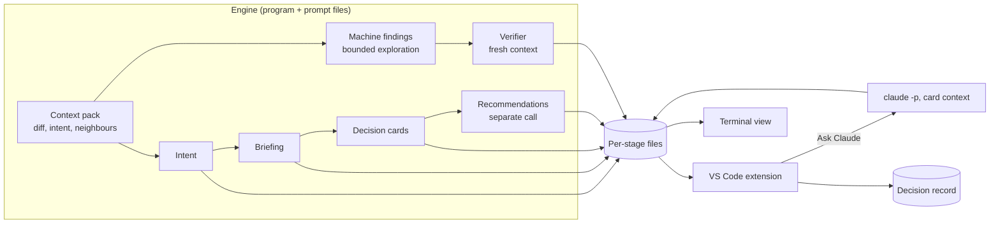

# High-Level Design: Duet

Duet is a two-layer code review tool: a person and Claude each doing the part of review they are suited to.

## Problem

Reviewing a change has two jobs that are routinely collapsed into one. One job is finding defects: bugs, security holes, convention violations. The other is human judgement: understanding what a change does and why, and owning the handful of decisions in it that a person must answer for.

AI reviewers do the first job well and the second badly. They produce long lists of comments, almost all about code improvement and defect detection, and almost none that help the reviewer understand design intent. When the AI that wrote a change also reviews it, the loop closes without a human forming a view at all. The reviewer's role decays into approving what a tool already approved.

The result is code that humans merged but did not understand, and decisions that were made by default instead of by someone accountable for them.

## Approach

Split review into two layers with different owners.

**The machine layer** is Claude's. It hunts bugs, security issues, test gaps, and convention violations, verifies its own findings adversarially, and reports them. This is a well-understood problem; the design borrows established patterns (parallel specialists, confidence filtering, a stated coverage footer) rather than inventing new ones.

**The human layer** is the product. It has three parts:

- **A briefing.** A short readable explanation of the change: what it claims to do, what the code actually does, the choices it made and what it chose against, and the changed code grouped into related chunks and ordered by dependency. A reviewer who has never seen the code can follow it. Every reason the briefing gives for a choice is labelled by where it came from: stated by the author (with the quote), inferred by Claude, or not found. An inferred reason is never presented as the author's.
- **A decision deck.** A small number of cards, each naming one judgement call the change makes: the question, why it matters in terms of users, data, money, or on-call, the reasonable options, and the code involved. The reviewer answers each card and, for high-stakes cards, writes a short rationale.
- **A guided tour** (planned, after the briefing and deck work). The briefing becomes a step-through of the real code, with decision cards appearing where they apply, the way a colleague would walk someone through a change.

The session ends with a **decision record**: what was asked, what the reviewer chose, why, and whether they agreed with Claude. The tool never approves a change. A person still approves it elsewhere.

The reviewer commits to a judgement before seeing Claude's opinion on high-stakes cards. Without that, the deck becomes one more polished rubber stamp.

## Target Users

- **A reviewer of someone else's change**, human or AI-authored, who does not know the intent and needs to understand the change quickly enough to own decisions in it.
- **An author reviewing their own AI-assisted change** before committing or opening a PR, who directed the work but has not read all of it and may believe the code does more or less than it does.

Both use the same output. For the first, the tool supplies the intent. For the second, it checks the code against the intent the author believes they gave.

Claude is reachable only through the Claude CLI. The tool must work for users whose environment offers no API access.

## Goals

- A reviewer can begin reading a usable briefing within about five minutes of starting a review, while slower work continues in the background.
- Every card is a decision a reasonable reviewer could answer differently, tied to a concrete consequence. A change with no such decisions yields no cards.
- Reviewers' choices are made independently of Claude's lean on high-stakes cards, and the record shows whether they were.
- Reviewers understand the change better after the briefing and tour than they would from reading the diff.
- A reviewer can ask Claude a question about a card without leaving the review, and the question and answer are kept with the card.
- A run interrupted by a rate limit or failure resumes without redoing completed stages.
- A reviewer can always tell which stages have completed, failed, or are still running, and an incomplete review is never presented as complete.
- Nothing is posted to a pull request or any other external system unless the reviewer has signed off on the exact text.

## Non-Goals

- Approving, blocking, or gating merges. The tool records decisions; it does not decide for anyone.
- Replacing the machine layer's mature competitors for bug finding. Its findings are shown, not its core contribution.
- Teaching a codebase over time (explaining unfamiliar patterns, linking prior decisions across PRs). The goal is understanding this change. Drawing on commit history, linked documents, and earlier changes to explain *this* change is in scope.
- Testing or grading reviewers. The tool asks reviewers for decisions and records them; it does not quiz them, score their rationales, or judge their answers.
- Containing any one organization's conventions, credentials, or internal tooling. Those belong in an overlay on the core (see Key Design Decisions).
- Self-tuning of which decisions become cards from reviewer feedback. Refinement comes from examples and issue reports.
- Supporting API or Agent SDK access to Claude.

## Tenets

Ordered; when two conflict, the higher one wins.

- **Judgement before opinion.** On high-stakes decisions, the reviewer forms a view before seeing Claude's, even when seeing it first would be faster.
- **Few earned cards over full coverage.** A short deck where every card names a real alternative and consequence beats a thorough one padded with decisions that do not matter.
- **Bounded and honest over exhaustive.** Claude explores within a stated budget and tells the reviewer what it did not look at, instead of digging until it feels certain.
- **Fail loud, not silent.** When a stage cannot complete correctly, surface that, rather than degrading quietly and presenting partial work as whole.
- **Usable early over complete late.** Show the reviewer what is ready now; let slower analysis arrive afterward.

## System Design

An engine produces structured files; interfaces display them. The engine is a program that owns the pipeline and calls the Claude CLI in headless mode for each stage. The prompts that direct each stage live in plain markdown files that anyone on the team can read and edit.

- **Context pack.** The change, normalized so generated files, lockfiles, and renames do not drown it; the author's reasoning (description, linked issues, commit messages, recent history of the changed code, linked documents, and any statement or plan the author supplies); the touched files; nearby project documents; tool output an environment can supply (such as an infrastructure plan); and direct callers, within a size limit. Each card states what it was based on.
- **Per-stage files.** Each stage writes its output as soon as it finishes, validated against a schema. Interfaces show each as it lands. Completed stages are cached, so a rerun or a resume redoes only what is missing or changed.
- **Human layer first.** Briefing and cards are on the reviewer's critical path. The machine layer runs in the background; its findings join the view as they arrive. Recommendations are produced by their own stage after the cards, so the reviewer can start answering before they exist. A high-stakes card's recommendation is revealed only after the reviewer commits; if its stage has not finished or has failed at that moment, the reveal says so and the commitment stands. Machine findings never add or change cards once the deck is shown; a finding that bears on a card is linked to it.
- **Visible stage status.** Every stage shows as pending, running, complete, or failed. A failed or unfinished stage, including a background machine-layer stage, is shown in the view where its results would have appeared, and the decision record states which stages were incomplete. A review is not presented as complete while any stage is.
- **Sources and sinks.** Reading a change (diff, description, existing comments) and writing back to it (posting comments) go through adapters, because environments reach GitHub differently, for example through an MCP server in one place and the `gh` CLI in another. The core depends on the adapter interface, not on any one access method. Writing back requires the reviewer's sign-off on the exact text first.
- **Interfaces.** A VS Code extension is the first interface: the briefing, the deck, a findings tree, inline threads on the code, and later the tour. A lighter terminal view reads the same files.
- **Questions.** Each card has an "Ask Claude" box. The extension runs the CLI headless with the card, its context pack, and the briefing; until the reviewer has committed, Claude's recommendation is withheld from that context, so declining to give a lean does not depend on Claude keeping a secret it was handed. The answer is shown on the card and kept with the review. An embedded terminal running interactive Claude remains available for longer conversations.

## Key Design Decisions

| Decision | Choice | Alternatives considered | Rationale |
|---|---|---|---|
| What the session ends with | A decision record; never an approval | A merge gate; no record | A gate turns the tool into the authority it exists to counter; no record loses accountability and the ability to measure whether judgement improved |
| Blind-first | Hard on high-stakes cards: choice, plus a short rationale, before Claude's lean; the tool cannot downgrade a card's stakes itself. Low-stakes cards may show the lean up front | Soft (collapsed but clickable); lean always visible | A collapsed lean gets clicked under time pressure; always-visible makes the deck an explainer with no forcing function. A tool that downgrades its own stakes quietly weakens the guarantee on the cards that matter |
| How the reviewer learns the change | Briefing, then deck; tour as the planned upgrade | Cards only with embedded context; on-demand explanation | Mechanical bulk needs explaining but not deciding; on-demand explanation fails exactly where reviewers do not know what they do not understand. A tour is the briefing with cards placed in the code |
| Delivery surface | Engine writes files; VS Code extension first, terminal view second | VS Code only; terminal only; browser UI | The tour needs the real code and editor; the engine and file format keep other interfaces cheap and let the human layer be tested before any UI exists |
| Engine shape | A program owns the pipeline and calls the CLI per stage; prompts are markdown files | A skill orchestrating inside an interactive session; a program with prompts embedded in code | Schema checks, the isolated verifier, and blind-first are guarantees Claude cannot be trusted to enforce on itself, so code owns them. Markdown prompts keep the part that most affects quality readable by the team |
| Claude access | Claude CLI only, including headless mode | API; Agent SDK | The target environment offers only the CLI |
| Language and packaging | TypeScript on Node throughout, in one repository of packages: the artifact store, the engine (with its command-line entry point), the review session, the adapters, and the VS Code extension | Engine in Python with a TypeScript extension | A VS Code extension must be TypeScript. One language lets the artifact store, which enforces the file contract, be a single library that every side imports, instead of two implementations of the contract that can disagree |
| Questions before the reviewer commits | Claude answers factual questions about a card but declines to say which option it would pick until the reviewer has committed | Answer anything and log asking early as a peek | Logging a peek after the fact lets the forcing function wear away one question at a time. Factual answers still serve the goal of understanding the change |
| Posting to a PR | Never without the reviewer's sign-off on the exact text | Post automatically; post a summary the reviewer approves in general terms | Posted text carries the reviewer's name and cannot be unsaid. Approving a draft in general terms is the same approval-by-default the tool exists to prevent |
| Organization-specific behavior | The public core defines adapter points and rule overrides; one organization's conventions, access methods, and internal rubrics live in a private overlay that is applied to the core, not in a fork | A fork per organization; organization-specific behavior inside the core | A fork drifts from the core and loses improvements; organization specifics in the core make it unpublishable and entangle general design with one environment's constraints |
| Which decisions become cards | Triggers always produce cards; Claude may propose more, but each must name a concrete reasonable alternative and what differs for users, data, cost, or on-call; a card may cover several trigger categories; a repository may lower a category's default stakes in its configuration, but Claude never may; proposed cards only fill the deck up to 7; trigger cards are never dropped to fit, and a deck over 7 tells the reviewer the change likely holds too many decisions for one review; zero is valid | Trigger list only; Claude's open judgement only; per-repo config only | A fixed list cannot see domain-specific calls; open judgement invents decisions and varies between runs. The floor makes the important cases unskippable and the alternative-and-consequence rule blocks invention. When the floor and the cap collide, the floor wins: a change with more unskippable decisions than one review can hold is itself worth telling the reviewer |
| Explaining the change's choices | The briefing lists the choices the change made, each with the alternative it chose against and a reason labelled stated, inferred, or not found; author reasoning is gathered from the description, commit messages, history, linked documents, an agent's plan when supplied, and, for an author reviewing their own work, a one-line statement of what they believe it does and why | Leave the why to the decision cards; let Claude explain without labelling sources | Cards ask what the code should do; understanding a change needs why it went the way it did. Unlabelled reasons let Claude's reconstruction pass as the author's intent, and agent-written changes often carry no stated rationale at all |
| Context | A bounded context pack and exploration budget; limits shown to the reviewer | Explore until confident | An unbounded machine review kept gathering context and ran for an hour on a small change. Claude cannot be fully aware of a codebase, and stating the limits is more useful than implying it was |
| Latency | Human layer first, stage-by-stage streaming, resumable cached stages | One run that finishes before anything is shown | Rate limits and slow stages are normal in the target environment; waiting for everything makes the tool one people skip |

## Success Metrics

- Time from starting a review to a readable briefing: about five minutes.
- Seeded-defect catch rate: reviewers using the tool catch known planted flaws at least as often as reviewers reading the diff without it.
- Pre-reveal disagreement with Claude is non-trivial. Near-zero disagreement combined with frequent post-reveal changes of mind is the signature of rubber-stamping.
- Card quality on a set of past PRs with known decisions: most real decisions covered, few invented cards.
- Falsification: if reviewers answer high-stakes cards faster than they could have read them, or the decision record is filled but unread, the tool is not producing judgement and the design is wrong.

## Open Questions

- **Stakes triggers.** The precise list of categories that always produce a card, and how "high stakes" is decided, belongs to a lower-level design.

## References

- `doc.md`: the research and early proposal this design grew from, including prior art in AI code review and the studies behind the blind-first and bounded-context choices.
