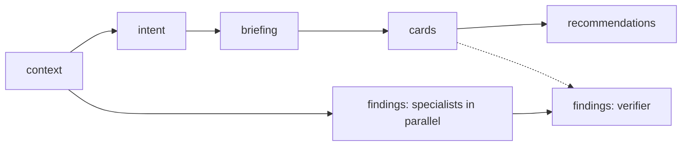

# Pipeline

## Context and Design Philosophy

The pipeline is the engine: a Node program that turns a change into the run files defined by the review-artifacts design, by calling the Claude CLI in headless mode once per unit of work. Code owns order, budgets, validation, retries, and failure; Claude owns the content of each stage. Prompts are markdown files, so the part that most affects quality can be read and edited without touching code.

Two shapes govern it. The human layer is a short serial chain on the reviewer's critical path and must be fast. The machine layer runs beside it, explores more, and is allowed to be slow, but never unbounded.

## Invocation

The engine exposes the `duet` command with three operations:

- **run**: review a change. The change is named as a pull request (resolved through the source adapter), a base and head ref, or the working tree against a base. An optional author statement (a line or two on what the change does and why) and an optional agent plan or transcript file can be supplied; both become intent sources. It creates or resumes the run and executes every stage that is not reusable.
- **ask**: answer a reviewer's question about one card in an existing run (see *Questions*).
- **clean**: remove run directories, their head worktrees, and their snapshot refs, for runs older than a given age or named explicitly.

As soon as `run` has created or found its run, it announces the run id on standard error, so an interface can open the review and show stages filling in while the engine works.

The VS Code extension and the review session call these operations; the engine never depends on them.

## Code at the Head Commit

Claude must read the code as it is at the head commit, not the reviewer's checkout. The engine creates a read-only git worktree of the head commit in a tool-owned location and runs every CLI call with that worktree as its working directory. The worktree is reused across stages and removed with the run.

## Stages

The two branches run concurrently. Within a branch, a stage starts when its upstream stages are complete. The verifier also waits for the cards stage to finish, complete or failed, so it can link findings to cards; specialists are usually slower than the human layer, so this rarely adds time.

| Stage | Done by | Reads | Claude tools |
|---|---|---|---|
| context | Code only | Source adapter, git, project files | none |
| intent | One CLI call | Context pack | none |
| briefing | One CLI call; produces cohorts, steps, and the change's choices | Context pack, intent | none |
| cards | Card-selection process (see card-selection design) | Context pack, intent, briefing | none |
| recommendations | One CLI call per card, fresh context | Context pack, briefing, one card | read-only |
| findings | Specialist calls in parallel, then a verifier | Context pack; the head worktree | read-only |

The briefing labels the reason for each choice it lists as stated, inferred, or none. A `stated` reason must quote an author-reasoning item in the pack, and the engine checks in code that the quote appears verbatim in the item it cites; a quote that does not is invalid output.

Human-layer stages get no tools by default: everything they need is in the context pack, which keeps them fast and their cost predictable. Recommendation and findings calls may read the worktree within their budget.

## Context Pack

The context pack is assembled by code, deterministically, so the same change always yields the same pack and the same cache keys.

**Normalizing the change.** Before anything is measured, the diff is computed with rename and copy detection and its files are classified. Lockfiles become a summary of the packages added, removed, and changed in version. Generated and vendored files (marked in `.gitattributes`, by a generated-file header, or by well-known paths) become a one-line note. Notebooks keep their cells with outputs removed. Binary and large-file-storage files become their path, size, and hash. Hunks that only rename, reformat, or reorder imports are collapsed into a summary. Each substitution is a `summarized-file` item and is listed with its reason.

**Items, in priority order:**

1. The normalized diff.
2. The author's reasoning: an author statement and agent plan when supplied, the title, description, and linked issue text from the source adapter, and the commit messages between base and head.
3. Changed files at head. A file over the per-file limit is included as an outline (its declarations, resources, or models) plus its changed hunks with surrounding lines.
4. Linked documents: in-repository documents linked from the description, and design-record directories whose paths match the changed files.
5. Project documents: the nearest instruction and README files above each changed path, then the repository root's, then the code-owner entries for the changed paths.
6. History: the most recent earlier commits that touched the changed lines, with their messages, up to a fixed count.
7. Tool output supplied by an environment through an adapter (for example, an infrastructure plan, a data-lineage report, or an API compatibility report).
8. Direct callers, from a caller resolver for the file's ecosystem where one is configured, otherwise by text search for names defined in changed files, skipping names on a stop-list of common words, capping matches per name, and taking the nearest by path distance first. When only text search was available, that limit is recorded as not examined.

The pack has a size budget in characters. Items are considered in priority order; an item that does not fit is excluded with the reason and later, smaller items are still considered. The normalized diff and the author's reasoning are never excluded: if they alone exceed the budget, the context stage fails with a message saying the change is too large to review as one, rather than reviewing part of it silently.

## Machine Layer

Specialists run in parallel, each a separate CLI call with its own prompt file: bugs, security, tests, and conventions. Each has an exploration budget: a maximum number of agent turns and a wall-clock timeout. A call that reaches its budget, by turns or by time, keeps what it has produced and states what it did not examine; a call that times out without output fails.

The engine merges specialist output, removes duplicates by fingerprint, and sends the findings to a verifier: a fresh CLI call that receives the diff, the context pack, the cards, and each finding's claim and evidence, but not the specialists' reasoning, and is instructed to refute. The verifier sets each finding's verification status and confidence. Findings that are refuted or below the confidence threshold (default 80) are not shown to the reviewer but are kept in the file for diagnosis. Findings are written once, after verification. A specialist failure fails the findings stage; the verifier is never skipped.

Each finding names the cards it bears on. If the cards stage failed, findings carry no card links and the findings stage still completes.

## Calling the CLI

Every call passes a prompt assembled from a prompt file and the stage's inputs, requests JSON output, and restricts tools to the stage's list. It passes no other flags by default, because managed environments restrict some (for example, an organization that defines its own MCP servers rejects options that replace them); arguments an environment does need come from the `claudeArgs` setting and are appended to every call. The model, turn limit, and timeout come from the prompt file's frontmatter, overridable by configuration. Output is validated through the artifact store.

- **Obvious omissions.** Before validation, the engine repairs omissions that have exactly one sensible fix (for example, a `stated` rationale missing its `text` takes the quote), so a formatting slip does not cost a retry.
- **Invalid output.** The engine validates each call's output before handing it to the artifact store. Each call gets one retry in total, whatever made the output unacceptable (schema errors or a stage's own checks, such as card coverage), with the problems listed in the retry prompt. A second unacceptable result fails the stage; nothing invalid is written.
- **Rate limits.** When the CLI reports a rate limit, the engine waits with exponential backoff up to a configured ceiling and retries. While waiting, the stage stays `running` and its entry says it is waiting on a rate limit and until when.
- **Concurrency.** At most a configured number of CLI calls run at once in one `run` (default 3), across both branches, with human-layer calls served first. `ask` calls are outside this cap.
- **Recommendations.** Each card's recommendation is written to `recommendations.json` as soon as it is produced, so a reviewer who commits early does not wait for the rest of the deck.

## Failure

A failed stage records its error. Every stage downstream of it in the same branch is marked failed with an error naming the upstream stage; none is skipped silently. A failure in the human layer never fails the findings stage, and a failure in the findings stage never fails a human-layer stage.

## Resume and Reuse

Only one `run` process works on a run at a time: it takes a lock file in the run directory (`ask` does not), and a second process for the same run exits with a message naming the holder. A lock whose process no longer exists is taken over.

On start, the engine asks the artifact store which stages are reusable and runs only the rest, in dependency order. Interrupting the engine leaves completed stages complete; a stage that was `running` is rerun.

## Questions

**ask** builds a fresh context for one question: the card, the context pack, the briefing, and the earlier questions and answers about the same card. It includes the card's recommendation only when the caller states that the reviewer may see it (the review session decides: after the reveal for high-stakes cards, as soon as it is shown for low-stakes ones). The call has read-only access to the head worktree with a small budget, and when the recommendation is withheld, its prompt tells Claude to answer factual questions and decline to say which option it would choose. The answer is returned to the caller; recording it is the review session's job.

## Decisions & Alternatives

| Decision | Chosen | Alternatives Considered | Rationale |
|---|---|---|---|
| Where Claude reads code | A read-only worktree of the head commit | The reviewer's checkout | The checkout may be on another branch or have local edits; reviews must describe the change, not the reviewer's machine |
| Human-layer tools | None by default; everything comes from the context pack | Free exploration | Exploration is what made reviews take an hour. A fixed pack keeps the briefing within minutes and makes cache keys deterministic |
| Context pack assembly | Deterministic code, priority order, explicit exclusions | Claude chooses what to read | Reproducible packs, predictable size, and an honest list of what was left out |
| Oversized change | Fail the context stage | Review a truncated diff | A partial review presented as whole is the failure the tenets rule out |
| Verifier input | Claims and evidence only, fresh call, instructed to refute | Same call self-checks; verifier sees specialists' reasoning | A model favors its own reasoning; separating the verifier from that reasoning is what makes the check worth having |
| Invalid output | One retry with the errors, then fail | Unlimited retries; accept with warnings | One retry fixes most formatting slips; more would hide a broken prompt |
| Concurrency | Global cap, human layer first | Unlimited parallelism | Self-inflicted rate limiting slows the critical path the cap protects |
| Normalizing the change | Summarize lockfiles, generated and vendored files, notebooks, binaries, and mechanical hunks before measuring size | Measure the raw diff | Raw diffs make a dependency bump or a package rename look too large to review, and drown the decisions in noise |
| Author reasoning in the pack | Commit messages, history of the changed lines, linked documents, and any author statement or agent plan, ranked just below the diff | Description and linked issue only | The reasons for a change usually live outside its description; without them, every explanation is Claude's guess |
| Caller discovery | A resolver per ecosystem where configured; text search with a stop-list and caps otherwise, its limits recorded | Text search only | Text search misses references in infrastructure, data, and dependency-injection code, and floods on common names |
| Retries | One per call, shared across all reasons | One per reason | Stacked retries multiply calls on the critical path and hide a broken prompt |
| Recommendations | One fresh call per card after the cards stage | Written by the card-writing call | A call that wrote the options would also have shaped them toward its favorite; separate calls keep the lean out of the card |

## Open Questions & Future Decisions

### Deferred
1. Default size budget for the context pack and default turn limits per specialist, to be set from measured runs.
2. Caller resolvers for specific ecosystems (language servers, build indexes, data-lineage manifests).

## References

- `docs/high-level-design.md`
- `docs/intent/review-artifacts/review-artifacts-design.md`
- `docs/intent/card-selection/card-selection-design.md`
