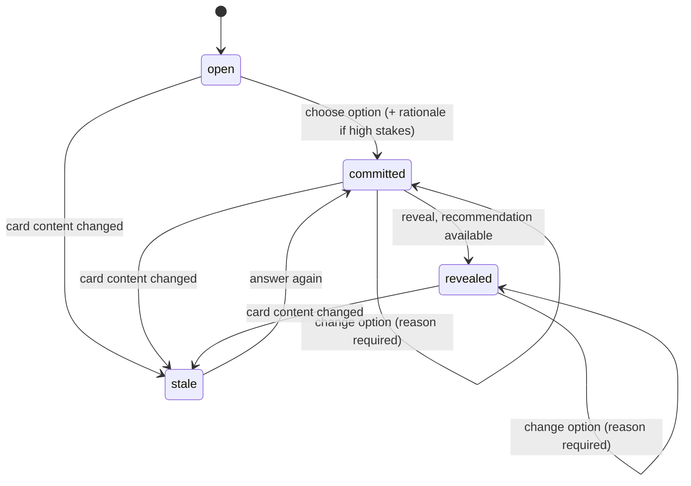

# Review Session

## Context and Design Philosophy

The review session is the interface-independent behavior of one reviewer working through one run: answering cards, seeing Claude's recommendations, asking questions, dismissing findings, and producing the decision record. It is a library that interfaces call. The interfaces draw; the session decides what may be shown and records what happened.

Blind-first lives here, not in any interface, so that every interface gets the same guarantee. An interface never reads `recommendations.json` itself; it asks the session, and the session answers according to the card's state.

The session records decisions; it does not judge them. Any rationale the reviewer writes is accepted as written.

## Reviewer

A session belongs to one reviewer, identified by the version-control user email of the repository, overridable by a setting. The identifier is made filename-safe for the `<reviewer>` part of the session file names.

## Card States

- **open.** For a high-stakes card, no recommendation is shown.
- **committed.** The reviewer has chosen an option. For a high-stakes card a rationale is also required; any non-empty text is accepted. Commitment is recorded at once.
- **revealed.** The recommendation is shown, and the reveal time and whether it matched the reviewer's option at that moment (`agreed_with_ai`) are recorded. For a high-stakes card this happens only after commitment. If the recommendation is not yet available (its stage is still running or failed, or its card hash does not match the current card), the reveal shows that state and the card stays committed; when the recommendation arrives, revealing it then records the time and the match.
- **changing an option.** After commitment the reviewer may change the option, giving a reason; each change is recorded.
- **stale.** A recorded answer whose card hash no longer matches the current card (matched by fingerprint) is shown as stale. Answering again replaces the entry and keeps the stale answer as previous.

**Low-stakes cards** show the recommendation as soon as it exists, before any choice; the reveal time is when it was first shown. Committing needs only an option, `agreed_with_ai` is set at commitment, and only changes after commitment need a reason.

## Questions

A reviewer can ask a question about any card in any state. The session calls the engine's **ask** operation, stating whether the reviewer may see that card's recommendation: for a high-stakes card only once it has been revealed, for a low-stakes card once it has been shown. The session appends the question and answer to the reviewer's question log. Counts of questions asked before commitment are derived from that log.

## Findings

The session reads findings through the artifact store, which applies the reviewer's states. The reviewer can mark a finding dismissed or fixed and reopen it; the state is stored by fingerprint so it survives reruns. Findings that are refuted or below the confidence threshold are not offered to the reviewer. A finding's cohort is the briefing cohort containing its first anchor's file, or "other" when none does.

## Ending a Review and the Record

The record is written on every change, not only at the end, so closing the editor loses nothing. If a session file fails validation, the session stops writing to it and tells the reviewer it must be repaired or moved aside, rather than overwrite it. Ending a review sets the end time and lists the stages that were not complete at that moment. A review can end with cards unanswered; they are absent from the record and the interface shows them as unanswered.

The session can produce a **decision log**: a markdown summary of each answered card (question, chosen option, rationale, whether it matched Claude's lean, whether it changed after commitment), the unanswered cards, and any incomplete stages. Posting it goes through the adapters: the session creates a signed post when the reviewer approves the exact text, and records the post, with its time, once the sink reports success.

## Decisions & Alternatives

| Decision | Chosen | Alternatives Considered | Rationale |
|---|---|---|---|
| Where blind-first is enforced | In the session library | In each interface | One implementation, one guarantee, for every interface |
| Rationale | Required on high-stakes cards; any non-empty text accepted | A minimum length; a quality check by Claude; a fill-in template | The tool records decisions and does not grade reviewers. Requiring some rationale keeps the moment of commitment deliberate without judging it |
| When Ask may discuss Claude's lean | After the reveal (high stakes), once shown (low stakes) | Right after commitment | Between commitment and reveal, Claude stating its pick would bypass the recorded reveal |
| Reveal with no recommendation | Card stays committed; reveal shows the stage state | Block commitment until recommendations exist; count it as revealed | The reviewer's judgement does not depend on Claude's; counting it as revealed would record a reveal of nothing |
| Stale answers | Matched by fingerprint; answering again replaces the entry and keeps the old one as previous | Match by card id; discard old answers | Ids can change between runs; fingerprints follow the question. Keeping the old answer preserves the history of the decision |
| Questions-before-commit count | Derived from the question log | Stored in the record | One source of truth |
| Persistence | Write the record on every change | Write at the end | Editors close and machines sleep; a half-finished review is still a record |
| Unanswered cards | Allowed; listed in the decision log | Require all cards answered to end | The tool does not gate; it makes what was not decided visible |
| Reviewer identity | Repository version-control email, overridable | Prompt every time; operating-system user | Already configured for commits, stable, and the same identity that appears on the change |

## Open Questions & Future Decisions

### Deferred
1. Detecting two open sessions for the same reviewer and run.
2. Carrying answers from an earlier run of a revised change, matched by card fingerprint.

## References

- `docs/high-level-design.md`
- `docs/intent/review-artifacts/review-artifacts-design.md`
- `docs/intent/pipeline/pipeline-design.md`
