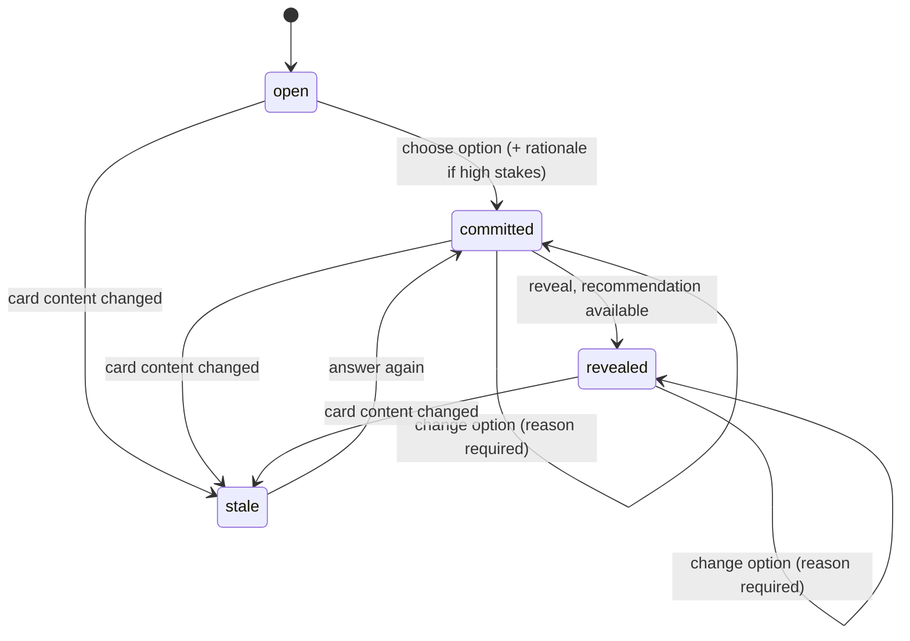

# Review Session

## Context and Design Philosophy

The review session is the interface-independent behavior of one reviewer working through one run: answering cards, seeing Claude's recommendations, asking questions, dismissing findings, and producing the decision record. It is a library that interfaces call. The interfaces draw; the session decides what may be shown and records what happened.

Blind-first lives here, not in any interface, so that every interface gets the same guarantee. An interface never reads `recommendations.json` itself; it asks the session, and the session answers according to the card's state.

The session records decisions; it does not judge them. Any rationale the reviewer writes is accepted as written.

## Reviewer

A session belongs to one reviewer, identified by the version-control user email of the repository, overridable by a setting. The identifier is made filename-safe for the `<reviewer>` part of the session file names.

## Card States



- **open.** For a high-stakes card, no recommendation is shown.
- **committed.** The reviewer has chosen an option. For a high-stakes card a rationale is also required; any non-empty text is accepted. Commitment is recorded at once.
- **revealed.** The recommendation is shown, and the reveal time and whether it matched the reviewer's option at that moment (`agreed_with_ai`) are recorded. For a high-stakes card this happens only after commitment. If the recommendation is not yet available (its stage is still running or failed, or its card hash does not match the current card), the reveal shows that state and the card stays committed; when the recommendation arrives, revealing it then records the time and the match.
- **changing an option.** After commitment the reviewer may change the option, giving a reason; each change is recorded.
- **stale.** A recorded answer whose card hash no longer matches the current card (matched by fingerprint) is shown as stale. Answering again replaces the entry and keeps the stale answer as previous.

**Low-stakes cards** show the recommendation as soon as it exists, before any choice; the reveal time is when it was first shown. Committing needs only an option, `agreed_with_ai` is set at commitment, and only changes after commitment need a reason.

## Questions

A reviewer can ask a question about any card in any state. The session calls the engine's **ask** operation, stating whether the reviewer may see that card's recommendation: for a high-stakes card only once it has been revealed, for a low-stakes card once it has been shown. The session appends the question and answer to the reviewer's question log. Counts of questions asked before commitment are derived from that log.

## Findings

The session reads findings through the artifact store, which applies the reviewer's states. The reviewer can mark a finding dismissed or fixed and reopen it; the state is stored by fingerprint so it survives reruns. Findings that are refuted or below the confidence threshold are not offered to the reviewer. A finding's cohort is the briefing cohort containing its first anchor's file, or "other" when none does.

## Ending a Review and the Record

The record is written on every change, not only at the end, so closing the editor loses nothing. If a session file fails validation, the session stops writing to it and tells the reviewer it must be repaired or moved aside, rather than overwrite it. Ending a review sets the end time and lists the stages that were not complete at that moment. A review can end with cards unanswered; they are absent from the record and the interface shows them as unanswered.

## Review Comment

The session produces the **review comment**: the markdown the reviewer may post to the pull request as one comment. It is written for GitHub's renderer and stays short however many cards and findings the review has: every card and finding is one collapsed line until it is expanded, and questions and titles are bold text, never headings.

```
## Duet review · <run title>
<what the code does, from the intent stage>
> [!WARNING] Stated vs. actual: <each mismatch>          (only when there are mismatches)
Human layer: 4/5 decisions answered · Machine layer: 7 findings

### 1 · Decisions
▸ 1. <question>                                          (collapsed)
  → <chosen option> (agreed with Claude | differed from Claude) | ⏳ Not answered
    expanded: link to the lines · what the code does · why it matters ·
              the options, chosen one marked · the reviewer's reasoning ·
              changed after commitment, when it was

### 2 · Machine review
| category      | 🔴 Critical | 🟠 High | 🟡 Medium | 🟢 Low |   counts; ⚪ Nit column only when a nit is shown
▾ 🟠 High (2)                                             (critical and high groups open)
  ▸ 🟠 <title> · <category> · sinks.ts:64-71              (each finding collapsed)
      expanded: link to the lines · evidence · suggested fix · confidence
▸ 🟡 Medium (4)                                           (medium, low, nit groups collapsed)
<N findings below the confidence threshold not shown>

<footer: posted with the reviewer's approval; Duet does not approve or block changes>
```

The decisions come first because they are what only this review produces. The machine review holds the findings the session offers the reviewer (verified, at or above the confidence threshold) that are still open, so the comment never shows what the reviewer was not shown, and leaves out what the reviewer dismissed or marked fixed. When no finding qualifies, the section says so instead of showing an empty table. Categories appear in a fixed order (bugs, security, tests, conventions), followed by any other category a specialist reports.

Line references link to the lines at the run's head commit when the interface supplies a code-link base for the repository (on GitHub, a permalink, which GitHub renders as the code itself); without one they are shown as `file:line` in code style. When a stage a section depends on is not complete, the section says so and names the stage instead of appearing empty, and the comment lists every stage not complete.

Text from the run (questions, titles, evidence) is inserted so it cannot break the comment's structure: inside the HTML of a collapsed line it is escaped and its inline code kept as code, and elsewhere angle brackets outside code are escaped.

A GitHub comment holds at most 65,536 characters. When the comment would be longer, the session drops the expanded details of findings, lowest severity first, until it fits, then whole findings the same way; the counts table and every decision always stay, and the comment says how many findings were shortened or left out.

Posting goes through the adapters: the session creates a signed post when the reviewer approves the exact text, and records the post, with its time, once the sink reports success.

## Decisions & Alternatives

| Decision | Chosen | Alternatives Considered | Rationale |
|---|---|---|---|
| Where blind-first is enforced | In the session library | In each interface | One implementation, one guarantee, for every interface |
| Rationale | Required on high-stakes cards; any non-empty text accepted | A minimum length; a quality check by Claude; a fill-in template | The tool records decisions and does not grade reviewers. Requiring some rationale keeps the moment of commitment deliberate without judging it |
| When Ask may discuss Claude's lean | After the reveal (high stakes), once shown (low stakes) | Right after commitment | Between commitment and reveal, Claude stating its pick would bypass the recorded reveal |
| Reveal with no recommendation | Card stays committed; reveal shows the stage state | Block commitment until recommendations exist; count it as revealed | The reviewer's judgement does not depend on Claude's; counting it as revealed would record a reveal of nothing |
| Stale answers | Matched by fingerprint; answering again replaces the entry and keeps the old one as previous | Match by card id; discard old answers | Ids can change between runs; fingerprints follow the question. Keeping the old answer preserves the history of the decision |
| Questions-before-commit count | Derived from the question log | Stored in the record | One source of truth |
| Persistence | Write the record on every change | Write at the end | Editors close and machines sleep; a half-finished review is still a record |
| Unanswered cards | Allowed; shown as not answered in the review comment | Require all cards answered to end | The tool does not gate; it makes what was not decided visible |
| Review comment layout | Summary, decisions, then machine review; every card and finding a collapsed line; findings counted in a category-by-severity table and grouped by severity, critical and high open | Findings first; headings per question; one flat list of findings | Decisions are this tool's product and lead. Collapsed lines keep a review with dozens of findings readable, and the table answers "how bad is it" before any reading. Headings per question made the comment shout |
| Findings in the comment | Open findings offered to the reviewer, with a count of those held back | Every finding; confirmed findings regardless of confidence; dismissed and fixed findings tagged | What is posted under the reviewer's name should be what the reviewer was shown and still stands behind; a dismissed or fixed finding is no longer a claim about the change |
| Comment over GitHub's size limit | Shorten findings, lowest severity first, and say so | Refuse to post; split into several comments | The decisions and the counts carry the review; low-severity detail is what a reader would skip first. One comment keeps the review in one place |
| Code links | Permalinks at the head commit from a code-link base the interface supplies; plain `file:line` otherwise | Links to the branch; the session discovering the remote itself | Permalinks keep pointing at the reviewed code after the branch moves. The session stays independent of where the repository is hosted |
| Reviewer identity | Repository version-control email, overridable | Prompt every time; operating-system user | Already configured for commits, stable, and the same identity that appears on the change |

## Open Questions & Future Decisions

### Deferred
1. Detecting two open sessions for the same reviewer and run.
2. Carrying answers from an earlier run of a revised change, matched by card fingerprint.

## References

- `docs/high-level-design.md`
- `docs/intent/review-artifacts/review-artifacts-design.md`
- `docs/intent/pipeline/pipeline-design.md`
